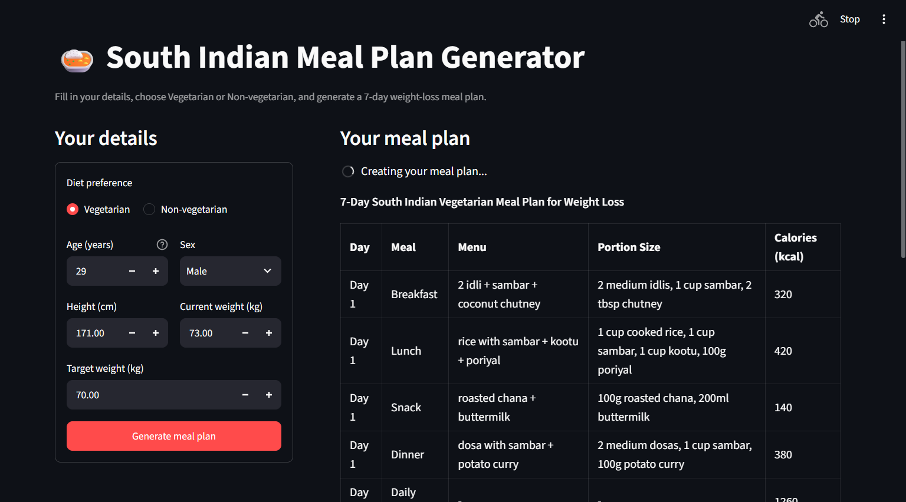
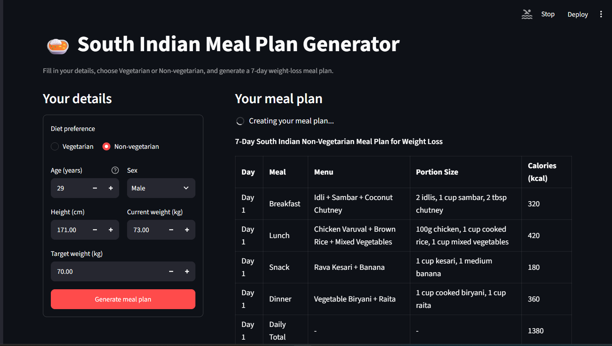

# Meal Plan Generator

This project generates a 7-day South Indian meal plan for weight loss, tailored to user preferences and dietary needs. The plan includes breakfast, lunch, snack, and dinner for each day, along with estimated calorie counts and a weekly shopping list.

## Screenshots

### Meal Plan Generator UI
### Vegetarian


### Non-Vegeterian


## Features

- Generates a personalized 7-day meal plan based on user input.
- Supports both vegetarian and non-vegetarian options.
- Includes estimated calorie counts for each meal.
- Provides a weekly shopping list.

## Tech Stack

- Python
- Streamlit
- Requests

## Project Structure

- `meal_plan.py`: Main script to generate the meal plan.

## Prerequisites

- Python 3.10+
- Streamlit
- Requests

## Installation

1. Clone the repository:
   ```bash
   git clone <repo-url>
   cd Prompting
   ```
2. Install dependencies:
   ```bash
   pip install streamlit requests
   ```

## How to Run

1. Run the script:
   ```bash
   streamlit run meal_plan.py
   ```
2. Open your browser to `http://localhost:8501` to see the meal plan generator.

## Usage Example

1. Enter your dietary preferences, age, sex, height, current weight, and target weight.
2. Click the "Generate Meal Plan" button.
3. View the generated meal plan and shopping list.

## Troubleshooting

- Ensure all dependencies are installed correctly.
- Check that the local model server is running and accessible.

## Contributing

Contributions are welcome! Please open an issue or submit a pull request for any improvements or bug fixes.
#
